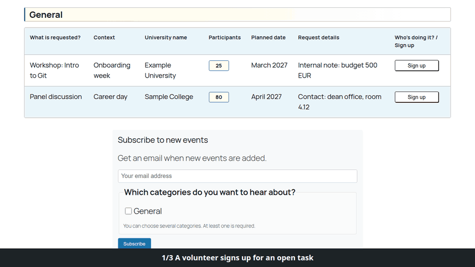
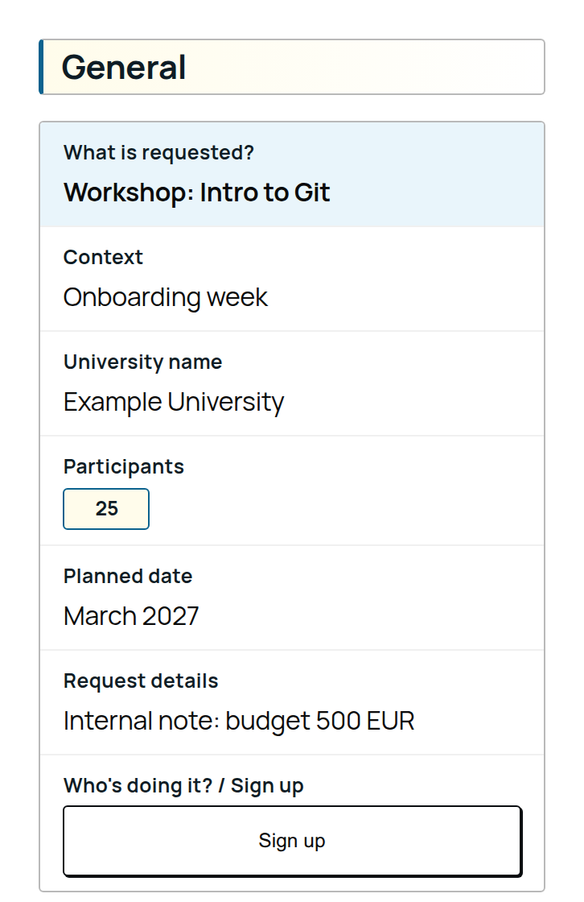
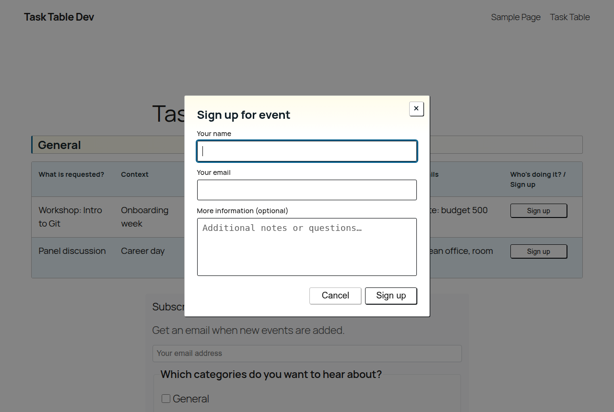
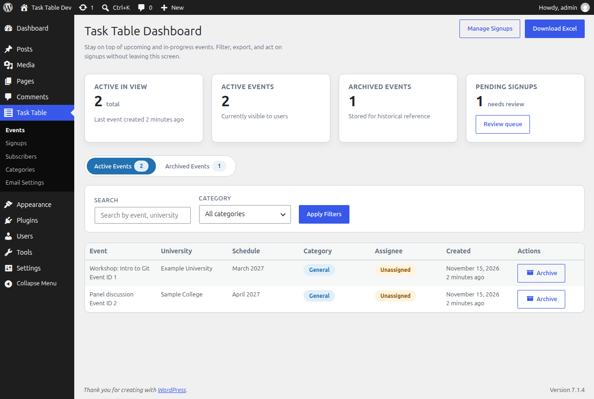

# Task Table

[](https://github.com/jomino151/task-table/actions/workflows/ci.yml)
[](CHANGELOG.md)


[](LICENSE)

> Publish open tasks, let volunteers sign up, and email subscribers when something new appears.



<!--
  "Try it" link: works only once the repository and the v1.3.0 release are public.
  Uncomment it then (the blueprint is docs/playground/blueprint.json).
[**Try it in WordPress Playground**](https://playground.wordpress.net/?blueprint-url=https://raw.githubusercontent.com/jomino151/task-table/main/docs/playground/blueprint.json)
(runs in your browser; email is not sent there).
-->

## Overview

Task Table is for organisations that hand out work to volunteers. Admins list open requests
in a table block, visitors sign up for them, and moderators approve or deny each signup.
It was built for a German non-profit that matches university requests (workshops, talks,
panels) with volunteer speakers, and it runs in production there.

### Features

- **Task table block**: one table per category, with rows edited in the block editor. Archived rows are hidden. On narrow screens each row becomes a card.
- **Signups with moderation**: an accessible signup dialog on the front end and approve/deny in wp-admin. Moderators get an email for each signup, and volunteers get one with the decision.
- **Subscriptions**: double opt-in per category. Every notification has a signed one-click unsubscribe link.
- **Admin screens**: events, signups, subscribers, categories, editable email templates and Excel export.
- **Translatable**: English by default, with a German translation included (`de_DE`, `de_DE_formal`). Every string uses the `task-table` text domain.

<table>
<tr><th>Task table and subscribe form</th><th>On a phone</th></tr>
<tr>
<td></td>
<td></td>
</tr>
</table>

| Signup dialog | Events admin |
|---|---|
|  |  |
| **Signup moderation** | **Email templates** |
|  |  |

How the subscriptions, signed links, rate limits and upgrade tests work, and a post-mortem of
the 1.2.0 security fix: [docs/design.md](docs/design.md).

## Requirements

- WordPress 6.7+
- PHP 7.4+, with `ZipArchive` for `.xlsx` export (it falls back to `.xls` without it)

## Installation

1. Get the plugin zip from the Releases page, or build it with `npm ci && npm run build && npm run plugin-zip`.
2. Upload it under **Plugins → Add New → Upload Plugin** and activate it.
3. Create categories under **Task Table → Categories**, then add the **Task Table** block (one per
   category, chosen in the block settings) and the **New event notifications** block to a page.

## Frequently Asked Questions

### Can I rename the columns?

Yes. The labels come from the `task_table_column_labels` filter:

```php
add_filter( 'task_table_column_labels', function ( $labels ) {
	$labels['name_hochschule'] = 'Organisation';
	return $labels;
} );
```

The other filters and the REST API are listed in [docs/reference.md](docs/reference.md).

### What personal data does it store?

- **Signups:** name, email and an optional note.
- **Subscribers:** email address and chosen categories.

Unsubscribing deletes the subscriber's address. Deleting the plugin removes all of its tables
and options.

### Where do I report security bugs?

Privately, through GitHub's vulnerability reporting. See [SECURITY.md](SECURITY.md).

Versions `<= 1.1.0` let any logged-in user export all events (CWE-862). This is fixed in 1.2.0;
see the [changelog](CHANGELOG.md) and the
[post-mortem](docs/design.md#post-mortem-missing-authorization-on-the-export-endpoint-cwe-862).

## Support Level

**Best effort:** maintained in spare time. Bug reports and security issues get a response, and
new features are unlikely.

## Development

The local stack (WordPress, MariaDB, Mailpit) runs in podman:

```bash
npm ci && npm run build
dev/up.sh              # http://localhost:8888 (admin/admin), mail at :8025, seeded with fictional data
dev/tests/run.sh       # integration tests
dev/tests/upgrade.sh   # upgrade from the previous release with production-like data
composer install && vendor/bin/phpcs   # WordPress coding standards
```

Source strings are English. After changing a string, add its German to both files in `languages/`
and run `python3 dev/make-translations.py` to rebuild the `.mo` files and the JSON files the block
scripts load. `node dev/screenshots.mjs` regenerates the screenshots in `docs/screenshots/`.

CI runs PHP 7.4/8.4 lint, PHPCS, JS and SCSS lint (`npm run lint:js`, `npm run lint:css`), a
gitleaks history scan and both test suites on every pull request.

To release, bump the version in `task-table.php`, `readme.txt` and `package.json`, add the entries to
`CHANGELOG.md` and `readme.txt`, merge to `main`, check with `dev/release-check.sh 1.3.0`, then push
the tag (`git tag v1.3.0 && git push origin v1.3.0`). The release workflow runs CI on the tag and
publishes the GitHub release with the tested zip and the changelog section as notes.

## Changelog

All notable changes are listed in [CHANGELOG.md](CHANGELOG.md).

## Contributing

Issues and pull requests are welcome. Please run `npm run lint:js`, `npm run lint:css`,
`dev/tests/run.sh` and `vendor/bin/phpcs` before opening a PR.

## License

[GPL-2.0-or-later](LICENSE)
