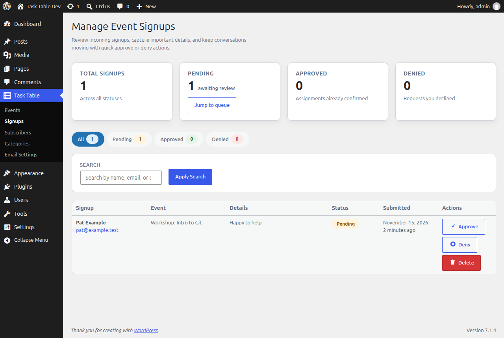
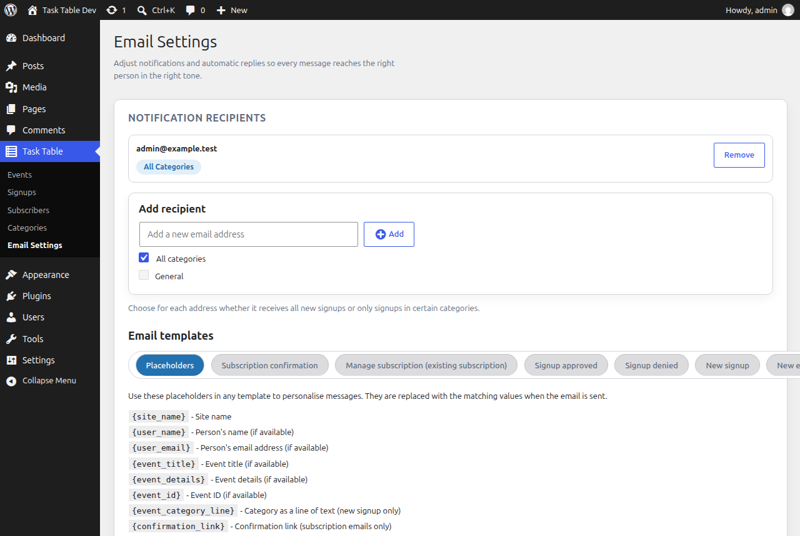

# Task Table

[](https://github.com/jomino151/task-table/actions/workflows/ci.yml)


[](LICENSE)

A WordPress plugin for organisations that hand out work to volunteers. Admins publish open
tasks, visitors sign up for them, moderators approve, and subscribers get an email when
something new appears.

It was built for a German non-profit that matches university requests (workshops, talks,
panels) with volunteer speakers. It runs in production there.


## Features

- **Task table block**: rows are edited in the block editor and grouped by category. Archived rows are hidden.
- **Signups**: visitors sign up in a modal; moderators approve or deny in wp-admin, and everyone gets an email.
- **Subscriptions**: double opt-in per category. Every notification has a signed one-click unsubscribe link.
- **Admin screens**: events, signups, subscribers, categories, editable email templates and Excel export.
- **Translatable**: German UI shipped, every string uses the `task-table` text domain.

| Signup modal | Events admin |
|---|---|
|  |  |
| **Signup moderation** | **Email templates** |
|  |  |

## Installation

Upload the plugin zip under **Plugins → Add New → Upload Plugin**, then add the **Task-Tabelle**
and **Neue Veranstaltungs-Benachrichtigung** blocks to a page. Get the zip from the Releases page, or build it:

```bash
npm ci && npm run build && npm run plugin-zip
```

## Security

- Admin and write routes require the `manage_task_table` capability, and admin actions check nonces.
- Public endpoints validate input and are rate limited. They don't reveal who is subscribed.
- Output is escaped late. Event HTML passes a narrow `wp_kses` allowlist.
- **Advisory:** in versions `<= 1.1.0`, any logged-in user could export all events
  (CWE-862, fixed in 1.2.0). See [CHANGELOG.md](CHANGELOG.md).

To report a vulnerability, see [SECURITY.md](SECURITY.md).

## Development

The local stack (WordPress, MariaDB, Mailpit) runs in podman:

```bash
npm ci && npm run build
dev/up.sh              # http://localhost:8888 (admin/admin), mail at :8025
dev/tests/run.sh       # integration tests
dev/tests/upgrade.sh   # upgrade from v1.1.0 with production-like data
vendor/bin/phpcs       # WordPress coding standards (after composer install)
```

CI runs PHP 7.4/8.4 lint, PHPCS, a gitleaks history scan and both test suites on every pull request.
The REST API, filters, data model and project layout are in [docs/reference.md](docs/reference.md).

## License

[GPL-2.0-or-later](LICENSE)
